<div align="center">
  
  <h1>Yiqi Workshop · 亿企工场</h1>
  <p><strong>A modular enterprise business platform powered by Vue 3 and Supabase</strong></p>
  <p>One shared platform for supply chain, manufacturing, warehouse, transportation, equipment, finance, HR, safety, and governed AI.</p>

  <p>
    <a href="https://gitee.com/art-si/art-supabase-pro">Gitee</a>
    ·
    <a href="https://github.com/art-si/art-supabase-pro">GitHub</a>
    ·
    <a href="https://art-si.github.io/art-supabase-pro/">Live Demo</a>
    ·
    <a href="./README.md">简体中文</a>
  </p>
</div>

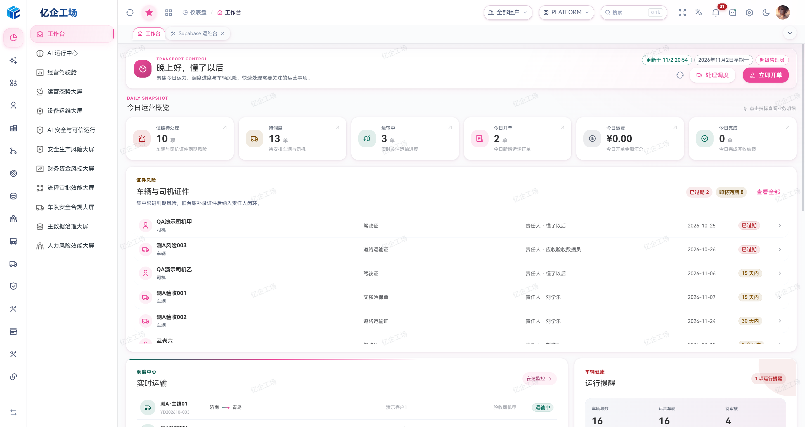

> The platform workspace shows operational metrics, vehicle and driver certificate risks, live transport, and fleet health. Figures and data vary by environment.

## Overview

Yiqi Workshop goes beyond a UI-only admin template. It uses Supabase Auth, PostgreSQL, RLS, Storage, Realtime, RPC, and Edge Functions as its backend foundation. A shared platform runtime and independently maintained domain repositories combine into one reproducible application.

The project currently includes:

- Enterprise platform capabilities: authentication, multi-tenancy, RBAC, dynamic menus, button permissions, dictionaries, attachments, system parameters, and audit records.
- End-to-end TMS operations: customers, carriers, drivers, cargo, contracts, stations, order entry, waybills, dispatching, delivery, in-transit monitoring, and financial settlement.
- Vehicle lifecycle management: archives, approval, insurance, inspection, maintenance, accidents, mileage, routine checks, parts, suppliers, and expiry reminders.
- Finance: transportation settlement, receivables, treasury, accounting, invoices, tax, fixed assets, payroll, and financial reporting.
- Human resources: organizations, positions, employee lifecycle, recruitment, workforce planning, attendance, compensation, performance, talent, and employee services.
- Safety management: dual prevention, special operations, hazardous waste, equipment ledgers, qualifications and training, emergency response, anti-violation programs, PPE, and accident management.
- Master data: cross-application governance, quality remediation and controlled changes, materials and numbering rules, BOMs, document types, production organizations, factory calendars, work centers, and process routes.
- Supply chain and warehouse: quotations, contracts, sales and purchase orders, delivery notices, stock movements, batches, transfers, inventory counts, and source tracing.
- Manufacturing and equipment operations: work orders, scheduling, shop-floor tasks, production reporting and review, packing, finished-goods receipt integration, inspections, maintenance, and repairs.
- Approval workflows: versioned definitions, conditional nodes, tasks, transfer, delegation, reminders, monitoring, callback compensation, and full audit trails.
- Governed AI capabilities: intelligent order entry, SQL assistant, project assistant, dispatch recommendations, transport anomaly analysis, cost review, profit diagnostics, receivables risk, vehicle health, OCR, and AI operations.

## Recent Improvements

This overview reflects committed implementation as of **November 2, 2026**. Availability depends on the target environment's backend contracts, configuration, and role permissions.

| Area | Current improvements |
| --- | --- |
| Supply chain and stock | Purchase-source conversion, partial receipts, sales stock posting, production material issues and returns, finished-goods receipts and returns, and packing-source tracing |
| Receivables and payables | Payable documents, payment conditions, settlement, automatic write-off, credit documents, red/blue offset previews, linked vouchers, and approvals |
| SQL workspace | Supabase, PostgreSQL, MySQL 8, and Dameng DM8 connections; lazy metadata, multiple tabs, search, sorting, charts, statistics, comparisons, and Excel/JSON exports; query cancellation is supported except DM8, which currently relies on timeouts |
| Authorized query APIs | Fixed read-only SQL, typed parameters, tenant-local account grants, cancellation, personal parameter presets, request examples, and OpenAPI 3.1 exports |
| Shared business UI | Configuration-driven ArtForm, consistent list/detail workspaces, field and column permissions, reference-aware master-data deletion, and persistent appearance preferences |
| Operations | Supabase operations workspace, backup/restore and delivery tools, pinned module manifests, project snapshots, and separate CloudBase build configuration |

Some MES shop-floor collection and cross-system traceability remain incomplete. Purchase-request conversion into MES plans and a unified WMS-to-TMS handover contract are still pending. Each module README describes its implemented scope and remaining boundaries.

## Connected Business Workflows

```text
MDM master data and production setup → SCM quotations, sales and purchasing → WMS stock
                  └→ MES work orders, scheduling and reporting ────────────────↑

TMS orders and dispatch → Driver field execution → FMS receivables, payables and settlement
          └→ VMS vehicles, certificates and maintenance

PMIS equipment · HR people · SMIS safety · Platform workflows, data and AI
```

These are business relationships; document conversion, stock posting and state changes depend on the server contracts already connected in each environment. See the [documentation site](https://art-si.github.io/art-supabase-doc/) and individual module READMEs for details.

## Repository Ecosystem

| Repository | Responsibility | Dev port | Mirror |
| --- | --- | --: | --- |
| [art-supabase-pro](https://gitee.com/art-si/art-supabase-pro) | Platform host, shared runtime, workflows, data center, and AI governance | `3006` | [GitHub](https://github.com/art-si/art-supabase-pro) |
| [art-supabase-fms](https://gitee.com/art-si/art-supabase-fms) | Accounting, receivables, payables, and transport settlement | `3012` | [GitHub](https://github.com/art-si/art-supabase-fms) |
| [art-supabase-hr](https://gitee.com/art-si/art-supabase-hr) | Human resources and talent operations | `3013` | [GitHub](https://github.com/art-si/art-supabase-hr) |
| [art-supabase-smis](https://gitee.com/art-si/art-supabase-smis) | Safety, training, and equipment governance | `3014` | [GitHub](https://github.com/art-si/art-supabase-smis) |
| [art-supabase-vms](https://gitee.com/art-si/art-supabase-vms) | Vehicle lifecycle management | `3015` | [GitHub](https://github.com/art-si/art-supabase-vms) |
| [art-supabase-tms](https://gitee.com/art-si/art-supabase-tms) | Transportation, dispatching, and execution | `3016` | [GitHub](https://github.com/art-si/art-supabase-tms) |
| [art-supabase-mdm](https://gitee.com/art-si/art-supabase-mdm) | Master-data governance and production configuration | `3017` | [GitHub](https://github.com/art-si/art-supabase-mdm) |
| [art-supabase-wms](https://gitee.com/art-si/art-supabase-wms) | Warehousing, stock movements, and traceability | `3018` | [GitHub](https://github.com/art-si/art-supabase-wms) |
| [art-supabase-mes](https://gitee.com/art-si/art-supabase-mes) | Manufacturing execution, work orders, scheduling, and reporting | `3019` | [GitHub](https://github.com/art-si/art-supabase-mes) |
| [art-supabase-pmis](https://gitee.com/art-si/art-supabase-pmis) | Equipment inspections, maintenance, and repairs | `3020` | [GitHub](https://github.com/art-si/art-supabase-pmis) |
| [art-supabase-scm](https://gitee.com/art-si/art-supabase-scm) | Quotations, sales, and procurement | `3021` | [GitHub](https://github.com/art-si/art-supabase-scm) |
| [art-supabase-site](https://gitee.com/art-si/art-supabase-site) | Independent website and product ecosystem | `3022` | [GitHub](https://github.com/art-si/art-supabase-site) |
| [art-supabase-doc](https://gitee.com/art-si/art-supabase-doc) | Product, development, deployment, and operations documentation | `5173` | [GitHub](https://github.com/art-si/art-supabase-doc) |

The main repository pins domain applications with Git submodules and supplies authentication, tenancy, navigation, permissions, layout, shared components, and the Supabase client. Domain repositories own their pages, APIs, types, and business rules. The driver app joins the same TMS execution lifecycle through controlled server contracts.

The companion [driver H5 / WeChat Mini Program](https://gitee.com/art-si/supabase-mobile-tms-driver) is maintained separately from these 12 submodules. See the [documentation site](https://art-si.github.io/art-supabase-doc/) for usage, development, and deployment guidance.

## Business Modules

| Module | Implemented scope |
| --- | --- |
| MDM | Source-governance directory, quality remediation, changes, golden records and distribution, material/warehouse master data, numbering, BOMs, document/business types, calendars, work centers, process routes, and accessory-processing lists |
| SCM | Sales and project quotations, contracts, orders, delivery notices and loading, purchase requests, contracts, orders, receiving notices, and subcontracting |
| WMS | Purchase/sales stock documents, production issues/returns, finished-goods receipts/returns, transfers, counts, batches, serial numbers, stock ledgers, and movement reports |
| MES | Work orders, process/BOM snapshots, scheduling and Gantt views, shop-floor tasks, reporting/review, packing, quality, and production analysis |
| PMIS | Equipment inspection, patrol, preventive maintenance, servicing, and repair plans, tasks, records, dashboards, and analysis |
| TMS / VMS | Transport order-to-delivery operations, return trips, commissions, certificate gates, 15 operational/business reports, mobile execution, vehicle lifecycle records, and fuel/electricity cards |
| FMS | Transport settlement, receivables/payables, treasury, accounting, invoices, tax, fixed assets, payroll, and reports |
| HR / SMIS | Employee and organization operations; safety master data, dual prevention, special operations, training, emergency response, PPE, and hazardous-waste management |
| Platform | System administration, approvals, recognition/review, AI governance, data tools, and operational command dashboards |

Purchase orders and receiving notices can feed WMS receipts; delivery notices feed sales stock-out; MES connects material requisitions and finished-goods receipts. Stock balances follow actual WMS posting. Manufacturing and equipment-maintenance events retain their own states, permissions, and audit records.

## Product Highlights

The screenshots below show platform and domain workspaces. Screens, permissions, and data depend on the deployed version and environment. The login and driver screenshots are earlier examples.

### Master data, warehousing, and manufacturing

The MDM overview organizes master records and completeness by business domain. The WMS workspace brings receiving, inventory, material requests, transfers, counts, and serial traceability together. The MES workspace presents the production execution stages and integration status.

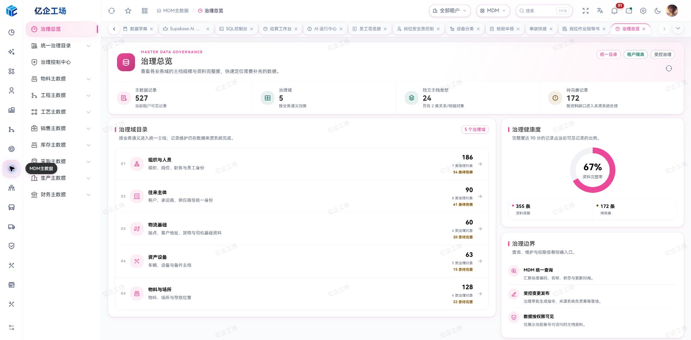

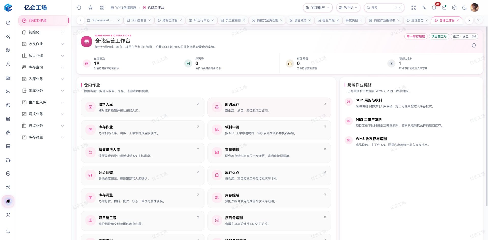

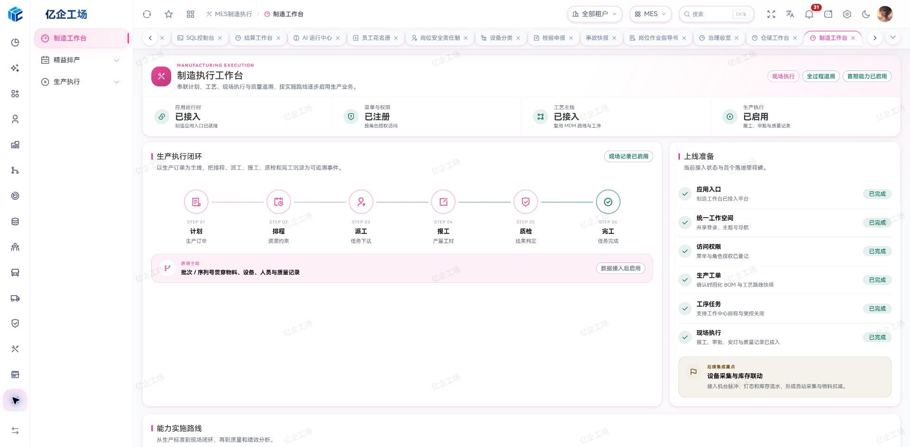

### AI-assisted order entry

Convert customer chats, transport instructions, and uploaded order images into a reviewable order draft. Enabled ordinary users can create master data in their own tenant through AI when they hold the corresponding business `Add` permission. Other controlled AI writes require platform-super authorization, and the operator remains responsible for the final save.

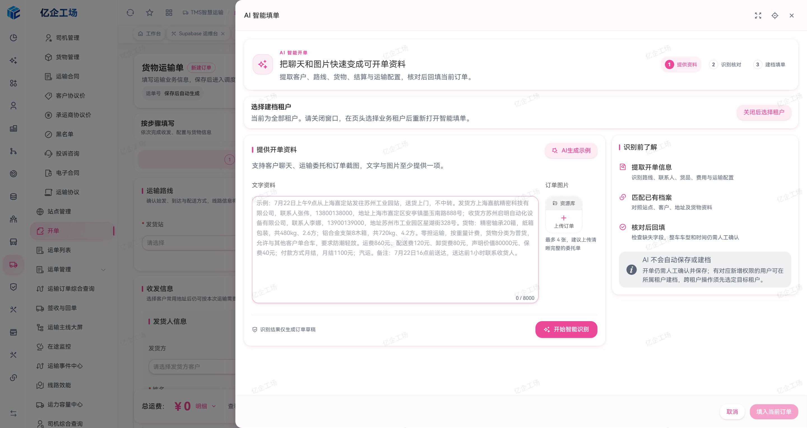

### Real-time transportation monitoring

Monitor vehicles, routes, progress, alerts, drivers, cargo, and remaining mileage in one operations cockpit, with quick access to AI anomaly analysis and response actions.

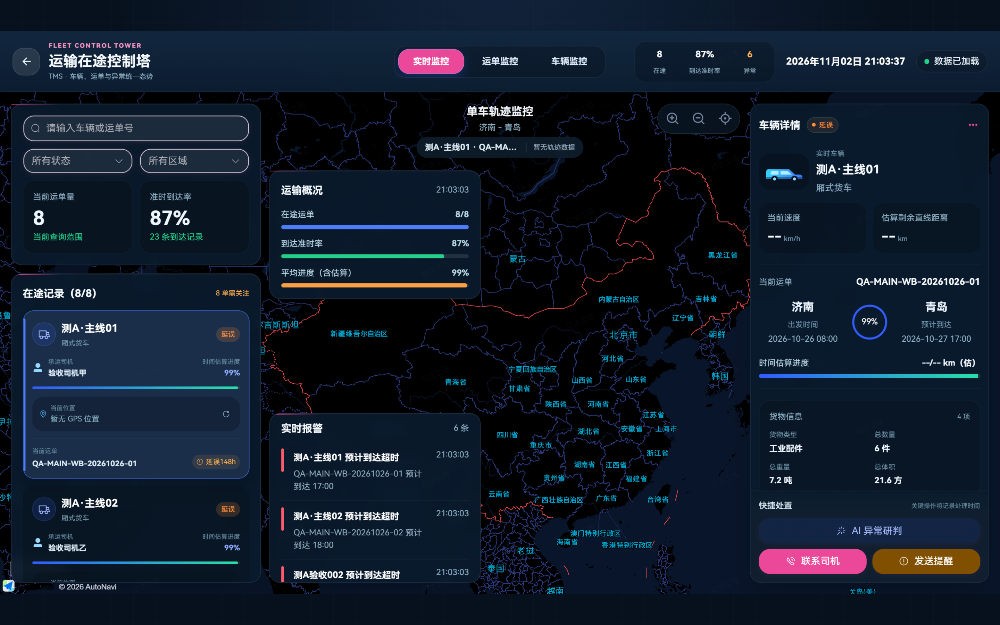

### Vehicle lifecycle record

Aggregate archives, drivers, parts, insurance, inspections, violations, accidents, maintenance, routine checks, mileage, and devices around a single vehicle.

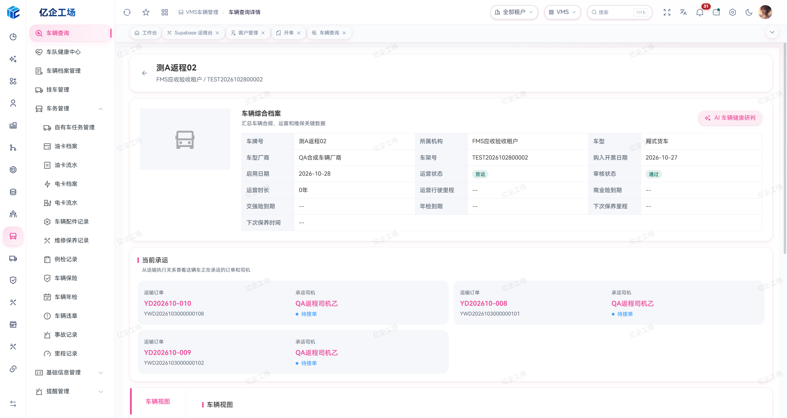

### Workflow governance

Published workflow versions remain immutable. Operators can inspect historical node snapshots, version differences, approval tasks, delegations, transfers, SLAs, and callback recovery.

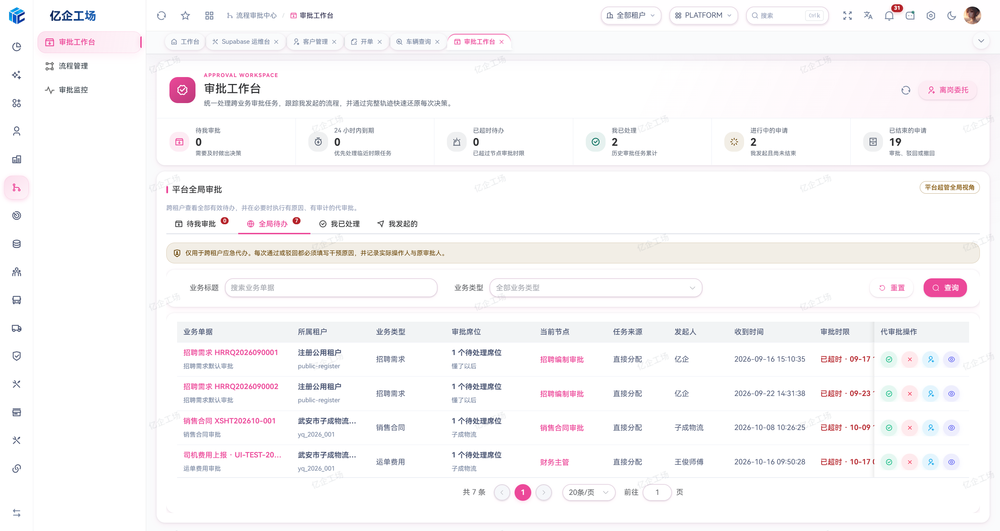

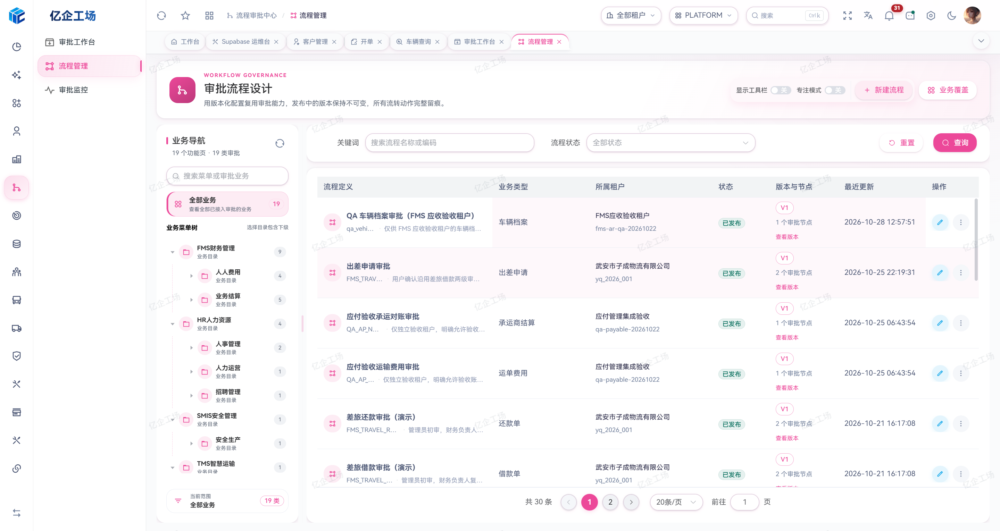

### Supabase project copilot

Browse database objects, views, functions, triggers, RLS policies, and Edge Functions, then ask a read-only project assistant for evidence-based analysis and governance recommendations.

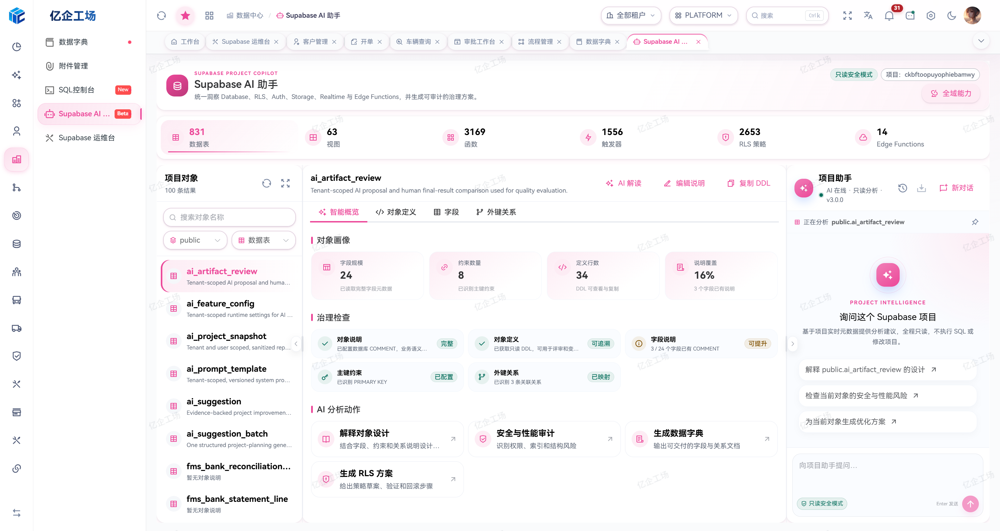

### Finance and AI operations

Track receivables, payables, collections, payments, invoices, cost review, and transport profit. The AI operations center provides observability for success rates, latency, token usage, capability adoption, quality signals, feedback, and failures.

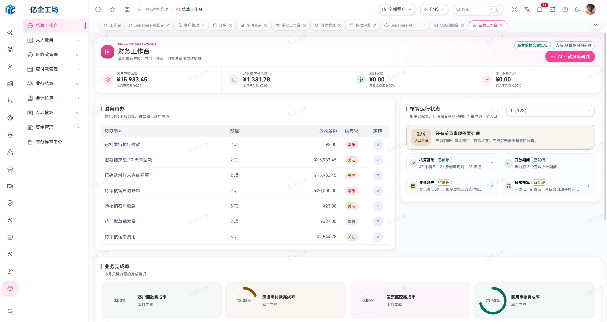

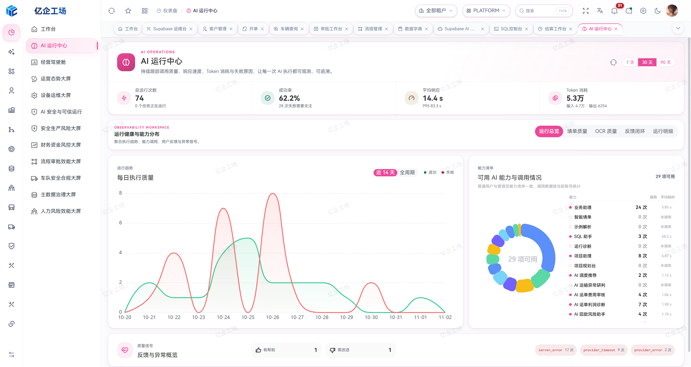

### HR and safety operations

HR connects organizations, positions, employee identities, employment status, account provisioning, and lifecycle history in one workspace. SMIS connects safety master data, equipment, qualifications, training, emergency response, PPE, tools, and incident governance.

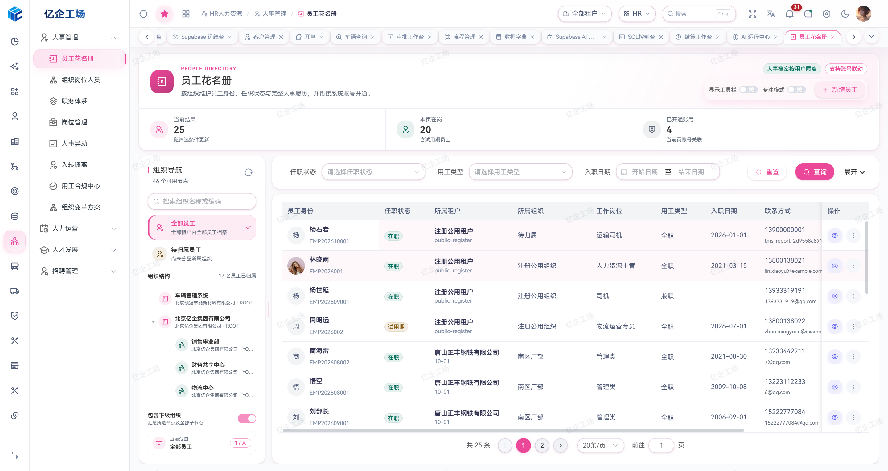

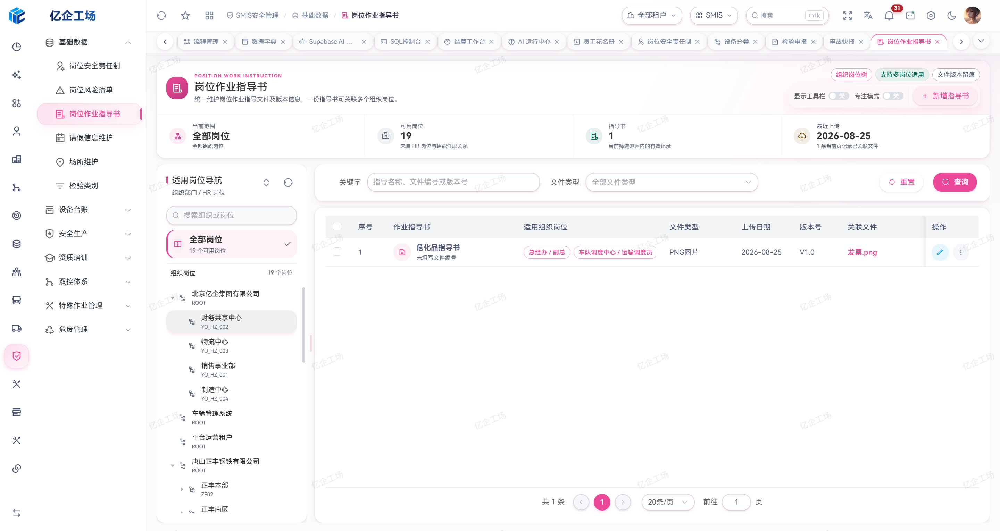

### TMS driver workspace

The H5 and WeChat Mini Program driver app brings the assigned vehicle, active task, transport milestones, remaining mileage, and field actions into one mobile workspace backed by controlled TMS lifecycle contracts.

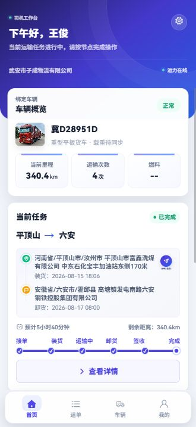

### Order entry and SQL workspace

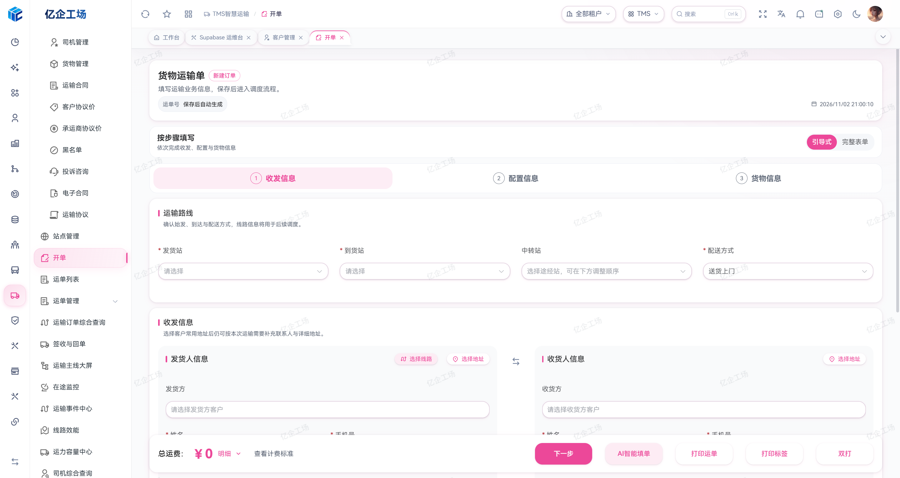

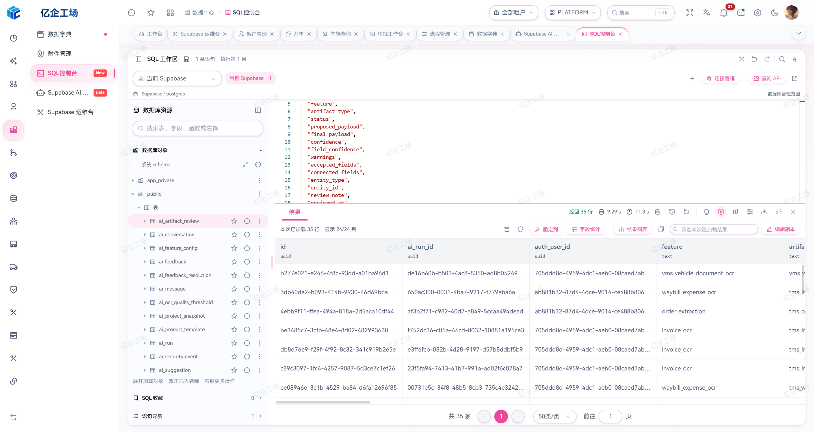

## Technology Stack

| Category             | Technologies                                                       |
| -------------------- | ------------------------------------------------------------------ |
| Frontend             | Vue 3, TypeScript, Vite, Vue Router, Pinia                         |
| UI and visualization | Element Plus, SCSS, Tailwind CSS, ECharts, Vue Flow                |
| Backend and data     | Supabase, PostgreSQL, RLS, Realtime, Storage, Edge Functions       |
| Editors and files    | Monaco Editor, Tiptap, ExcelJS, File Viewer, XGPlayer              |
| Quality              | ESLint, Prettier, Stylelint, vue-tsc, Playwright, Node Test Runner |

## Quick Start

Requirements:

- Node.js `>= 22.13.0`
- pnpm `>= 11.28.2` (currently pinned to `11.28.2`)
- A Supabase project configured with the required business database, Auth, Storage, and Edge Functions; frontend installation does not provision the backend

```bash
git clone --recurse-submodules https://gitee.com/art-si/art-supabase-pro.git
cd art-supabase-pro
pnpm install
```

You can also clone the [GitHub mirror](https://github.com/art-si/art-supabase-pro). Submodule URLs in `.gitmodules` default to Gitee. For an existing non-recursive checkout, run `git submodule update --init --recursive`. Use `pnpm modules:install` to install module dependencies at the pinned revisions, or `pnpm modules:setup` for the complete preparation/build workflow.

Configure `.env` or `.env.development`:

```env
VITE_SUPABASE_URL=https://your-project.supabase.co
VITE_SUPABASE_KEY=your-supabase-anon-key

# Optional: required by the in-transit map
VITE_AMAP_KEY=your-amap-key
VITE_AMAP_SECURITY_JS_CODE=your-amap-security-code
```

Run the application:

```bash
pnpm dev
```

Run quality checks and create a production build:

```bash
pnpm check
pnpm build
```

> Expose only a Supabase publishable key or compatible `anon` key to the frontend. Keep `service_role`, AI provider keys, and other server credentials behind database functions or Edge Functions, and enforce access with RLS.

## Development and Publishing

The host owns reusable utilities, composables, shared business components, authentication, tenancy, and permissions. Modules import shared implementations through `@/` and retain domain-specific rules. Menu URLs, menu component paths, and `src/views/**/index.vue` entries must align segment by segment.

| Command | Purpose |
| --- | --- |
| `pnpm sql:gateway` | Start the background executor for external read-only database connections |
| `pnpm check:fast` | Icon, UI, reuse, dependency, permission, database-security, type, lint, and unit checks |
| `pnpm check` | Add Stylelint to the fast checks |
| `pnpm check:ci` | Full checks, coverage, project snapshot, production build, bundle budget, and browser regressions |
| `pnpm modules:status` | Inspect the 12 submodule revisions |
| `pnpm modules:check` | Run each module's declared checks |
| `pnpm modules:build` | Build all modules |
| `pnpm repo:pull` | Update the host and submodule branches |
| `pnpm repo:publish -- "docs: refresh project overview"` | Build publication output and commit/push changed repositories |

`repo:publish` includes all current workspace changes, builds affected `docs` output, commits modules before the host, updates the pinned module manifest, and regenerates the AI project snapshot. It pushes each repository's configured upstream; GitHub and Gitee mirrors require separate pushes.

Host and business-module `docs/` directories contain published build output. In contrast, `modules/art-supabase-doc/docs/` contains documentation source. Preserve both, along with versioned tests and visual baselines. See [tests/README.md](tests/README.md) for test boundaries.

## Permissions and Data Boundaries

- Ordinary users and tenant administrators remain within their authenticated tenant. Only platform super administrators can switch tenant scope.
- Platform-all reads across tenants; a concrete selection restricts reads to that tenant. New root records in platform-all default to the administrator's authenticated tenant, while existing-row mutations and child records use the record or parent tenant.
- Enabled ordinary users can use authorized AI and create tenant-owned master data with the corresponding business `Add` permission. Other AI mutations, configuration, publishing, and workflow changes require platform-super checks in both UI and server boundaries.
- Master-data deletion checks business references before confirmation and blocks failed or unauthorized checks. Server-side reference, tenant, and permission checks remain authoritative.
- Raw SQL on the platform Supabase project requires platform-super authorization. Ordinary users access external read-only connections or fixed query APIs only through explicit tenant-local grants.

## License and Credits

Yiqi Workshop is released under the [Mulan Permissive Software License, Version 2 (MulanPSL-2.0)](LICENSE).

The interface uses HarmonyOS Sans Fonts, copyright © Huawei Device Co., Ltd. The fonts are distributed under the separate [HarmonyOS Sans Fonts License Agreement](public/fonts/HarmonyOS-Sans-LICENSE.txt).

Thanks to the open-source community for its contributions to the interface foundations.
