<div align="center">
  
  <h1>亿企工场</h1>
  <p><strong>Vue 3 + Supabase 驱动的模块化企业业务平台</strong></p>
  <p>统一平台底座，连接供应链、生产、仓储、运输、设备、财务、人力、安全生产与可治理 AI。</p>

  <p>
    <a href="https://gitee.com/art-si/art-supabase-pro">Gitee</a>
    ·
    <a href="https://github.com/art-si/art-supabase-pro">GitHub</a>
    ·
    <a href="https://art-si.github.io/art-supabase-pro/">在线演示</a>
    ·
    <a href="./README.en.md">English</a>
  </p>

  <p>
    
    
    
    
    
  </p>
</div>

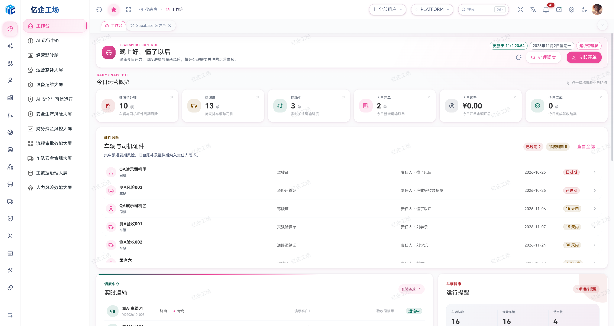

> 平台工作台展示运营概览、车辆与司机证件风险、实时运输和车辆健康。截图为运行时画面，指标与数据随环境变化。

## 项目定位

亿企工场不是只展示表格、表单和图表的 UI 模板。它以 **Supabase Auth、PostgreSQL、RLS、Storage、Realtime、RPC 与 Edge Functions** 为后端基础，以主平台统一公共运行时、业务子仓独立演进的方式，提供可以继续落地和二次开发的企业业务能力。

项目当前已经覆盖：

- 企业级基础平台：登录认证、多租户、RBAC、动态菜单、按钮权限、数据字典、附件、系统参数与审计。
- TMS 运输全链路：客户、承运商、司机、货物、合同、站点、开单、订单、运单、配载、配送、在途监控与财务结算。
- 车辆全生命周期：车辆档案、入档审核、保险、年检、维修、事故、里程、例检、配件与到期提醒。
- 财务管理：运输结算、应收账龄、资金、会计核算、票据、税务、固定资产、薪资与财务报表。
- 人力资源：组织岗位、员工生命周期、招聘、编制、考勤、薪酬福利、绩效、人才与员工服务。
- 安全生产：双重预防、特殊作业、危险废物、设备台账、资质培训、应急救援、反违章、劳保用品与事故管理。
- 主数据与生产基础：跨应用主档目录、质量整改与变更治理、物料编码、BOM、单据类型、生产组织、工厂日历、工作中心与工艺路线。
- 供应链与仓储：报价、销售合同与订单、采购申请与订单、收发货通知、出入库、库存批次、调拨、盘点与来源追溯。
- 制造执行与设备运营：生产工单、排程、现场任务、报工审核、排包、完工入库联动，以及点巡检、保养、维修计划与任务。
- 审批工作流：版本化流程、条件节点、任务处理、转交、委托、催办、监控、回调补偿与完整审计轨迹。
- AI 业务能力：智能填单、SQL 助手、项目助手、调度推荐、运输异常研判、费用审核、利润诊断、回款风险、车辆健康、票据/OCR 与质量运营。

## 近期完善的能力

本轮说明按截至 **2026-11-02** 的已提交代码整理；业务是否可用仍取决于目标环境的后端契约、配置与角色授权。

| 方向 | 当前改进 |
| --- | --- |
| 供应链与生产库存 | 采购来源下推、分批入库、销售出库审核记账、生产领退料、完工入退库、排包来源与库存流水关联 |
| 应收与应付 | 应付款单、付款条件、结算、自动核销、红字与红蓝核销预览，以及关联凭证和审批处理 |
| SQL 工作台 | Supabase / PostgreSQL / MySQL 8 / 达梦 DM8 数据源、按需元数据、多页签、结果搜索与排序、图表、统计、对比及 Excel / JSON 导出；支持查询取消，DM8 当前按超时结束 |
| 授权查询 API | 固定只读 SQL、类型化参数、租户内账号授权、调用取消、个人参数方案、请求示例与 OpenAPI 3.1 导出 |
| 通用业务体验 | 配置式 ArtForm、统一列表与详情工作区、字段和列权限、主数据删除引用检查、外观偏好持久化 |
| 平台运维 | Supabase 运维入口、备份恢复与项目交付工具、子仓版本清单、发布快照，以及独立的 CloudBase 构建配置 |

MES 的部分现场采集与跨系统全程追溯仍需完善；SCM 到 MES 的采购申请生成计划、WMS 到 TMS 的统一交接契约仍待接通。下文按已接入能力介绍各仓，详细业务边界见对应子仓 README。

## 从基础资料到业务执行

平台以统一身份、租户和权限为基础，各业务应用围绕自己的单据和业务规则协同：

```text
MDM 主数据与生产基础 ──→ SCM 报价、销售与采购 ──→ WMS 收发与库存
         │                                         ↑
         └──→ MES 工单、排程、报工与完工 ──────────┘

TMS 订单、调度与运输 ──→ 司机现场执行 ──→ FMS 应收应付与结算
          │
          └──→ VMS 车辆、证件与维护

PMIS 设备维护 · HR 组织人员 · SMIS 安全生产 · 平台审批、数据与 AI
```

图中表示业务协作关系；各环节的下推、过账和状态流转以已接通的服务端契约为准。更多操作说明参见 [业务模块文档](https://art-si.github.io/art-supabase-doc/) 和下方各仓链接。

## 项目全景

| 仓库 | 定位 | 独立开发端口 | 代码镜像 |
| --- | --- | --: | --- |
| [art-supabase-pro](https://gitee.com/art-si/art-supabase-pro) | 平台宿主、公共运行时、审批、数据中心与 AI 治理 | `3006` | [GitHub](https://github.com/art-si/art-supabase-pro) |
| [art-supabase-fms](https://gitee.com/art-si/art-supabase-fms) | 财务核算、应收应付与运输结算 | `3012` | [GitHub](https://github.com/art-si/art-supabase-fms) |
| [art-supabase-hr](https://gitee.com/art-si/art-supabase-hr) | 人力资源、组织与人才运营 | `3013` | [GitHub](https://github.com/art-si/art-supabase-hr) |
| [art-supabase-smis](https://gitee.com/art-si/art-supabase-smis) | 安全生产、资质培训与设备治理 | `3014` | [GitHub](https://github.com/art-si/art-supabase-smis) |
| [art-supabase-vms](https://gitee.com/art-si/art-supabase-vms) | 车辆全生命周期管理 | `3015` | [GitHub](https://github.com/art-si/art-supabase-vms) |
| [art-supabase-tms](https://gitee.com/art-si/art-supabase-tms) | 智慧运输、调度与履约协同 | `3016` | [GitHub](https://github.com/art-si/art-supabase-tms) |
| [art-supabase-mdm](https://gitee.com/art-si/art-supabase-mdm) | 主数据治理与生产基础配置 | `3017` | [GitHub](https://github.com/art-si/art-supabase-mdm) |
| [art-supabase-wms](https://gitee.com/art-si/art-supabase-wms) | 仓储、出入库、库存与追溯 | `3018` | [GitHub](https://github.com/art-si/art-supabase-wms) |
| [art-supabase-mes](https://gitee.com/art-si/art-supabase-mes) | 制造执行、工单、排程与报工 | `3019` | [GitHub](https://github.com/art-si/art-supabase-mes) |
| [art-supabase-pmis](https://gitee.com/art-si/art-supabase-pmis) | 设备点巡检、保养与维修运营 | `3020` | [GitHub](https://github.com/art-si/art-supabase-pmis) |
| [art-supabase-scm](https://gitee.com/art-si/art-supabase-scm) | 供应链报价、销售与采购 | `3021` | [GitHub](https://github.com/art-si/art-supabase-scm) |
| [art-supabase-site](https://gitee.com/art-si/art-supabase-site) | 独立官网与产品矩阵 | `3022` | [GitHub](https://github.com/art-si/art-supabase-site) |
| [art-supabase-doc](https://gitee.com/art-si/art-supabase-doc) | 使用、开发、部署与运维文档站 | `5173` | [GitHub](https://github.com/art-si/art-supabase-doc) |

主仓通过 Git submodule 固定各业务应用的提交，统一装载认证、租户、菜单、权限、布局、公共组件和 Supabase 客户端。业务仓保留领域页面、API、类型与规则的所有权；司机端通过受控服务端契约与 TMS 共享同一条运单履约链路。

配套的 [司机 H5 / 微信小程序](https://gitee.com/art-si/supabase-mobile-tms-driver) 独立维护，不属于上述 12 个 Git 子模块。产品使用与开发说明见 [文档站](https://art-si.github.io/art-supabase-doc/)。

## 为什么值得关注

| 能力              | 项目提供的实现                                                               |
| ----------------- | ---------------------------------------------------------------------------- |
| Supabase 原生后端 | Auth、PostgreSQL、RLS、Storage、Realtime、RPC、Edge Functions 深度集成       |
| 多租户与权限      | 租户级数据隔离、角色菜单、按钮权限、平台超级管理员边界                       |
| 真实业务闭环      | 从运输开单、调度、在途、签收，到对账、收付款、发票、利润分析                 |
| 可治理的 AI       | 普通用户可用的只读能力与按权限建档、受控写入、运行审计及反馈闭环             |
| 可复用审批引擎    | 版本不可变、条件路由、审批任务、委托转交、SLA、通知、回调与补偿              |
| 工程化前端        | Vue 3、TypeScript、Vite、Pinia、Element Plus、Monaco、ECharts 与统一业务组件 |

## 核心功能实拍

以下为产品运行截图，展示平台与业务应用的主要工作区。页面、权限和数据会随运行版本与环境配置变化；登录和司机端截图为此前留存的展示画面。

### MDM 主数据治理

治理总览按组织人员、往来主体、物流基础、资产设备、物料场所归集主档，展示资料完整度并引导用户回到权威来源维护。

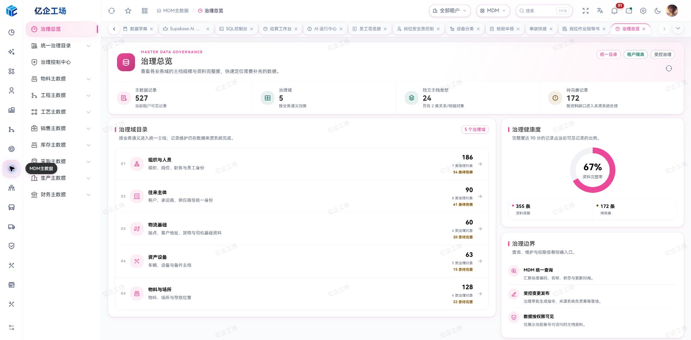

### WMS 仓储运营

工作台集中连接收料、即时库存、领料、调拨、盘点和序列号追溯，并展示 SCM 采购与 MES 生产的仓储协作入口。

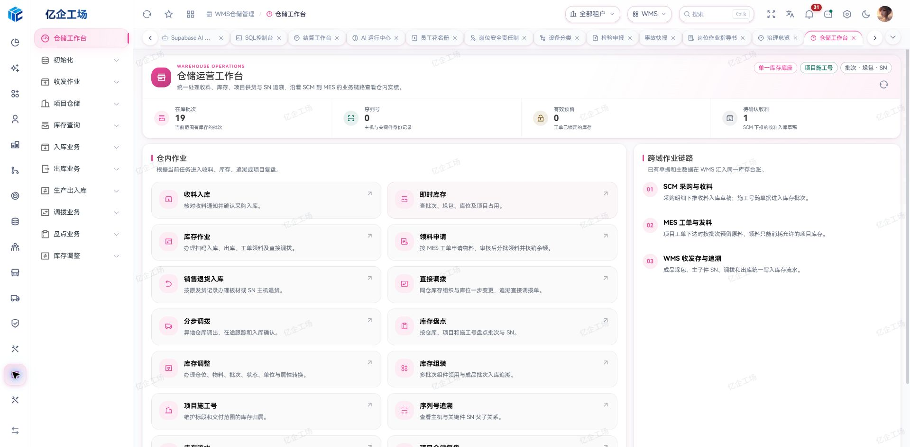

### MES 制造执行

制造工作台展示计划、排程、派工、报工、质检与完工的业务主线，同时说明现场执行接入进度和后续集成重点。

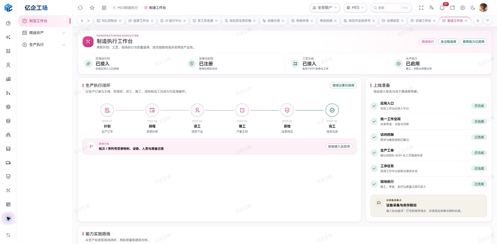

### AI 智能填单

支持粘贴客户聊天、运输委托等文字资料，也可以上传订单图片。AI 完成识别、字段核对、主数据匹配与建档建议，最终由操作人员确认后回填订单，避免 AI 越权直接保存业务数据。

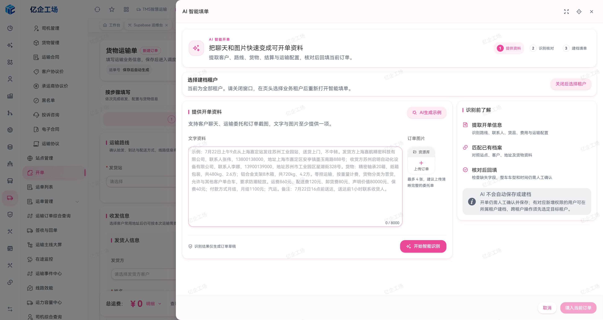

### TMS 实时在途监控

在同一驾驶舱内查看在途车辆、运输进度、线路、实时报警、司机与货物信息，并提供 AI 异常研判和快捷处置入口。

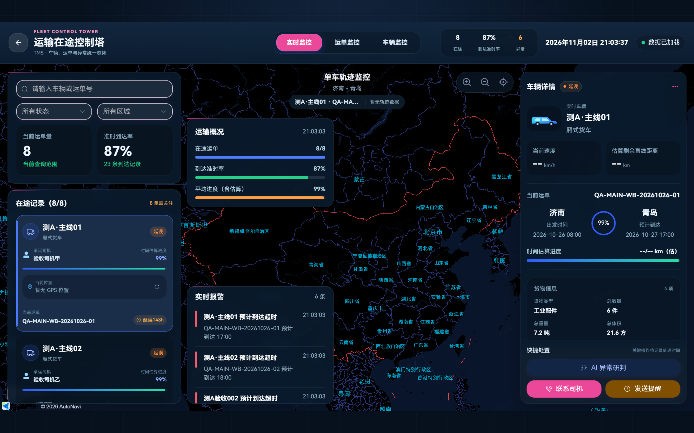

### 一车一档与车辆健康

围绕单车聚合档案、司机、零部件、保险、年检、违章、事故、维修保养、例检、里程和设备信息，并提供 AI 车辆健康研判。

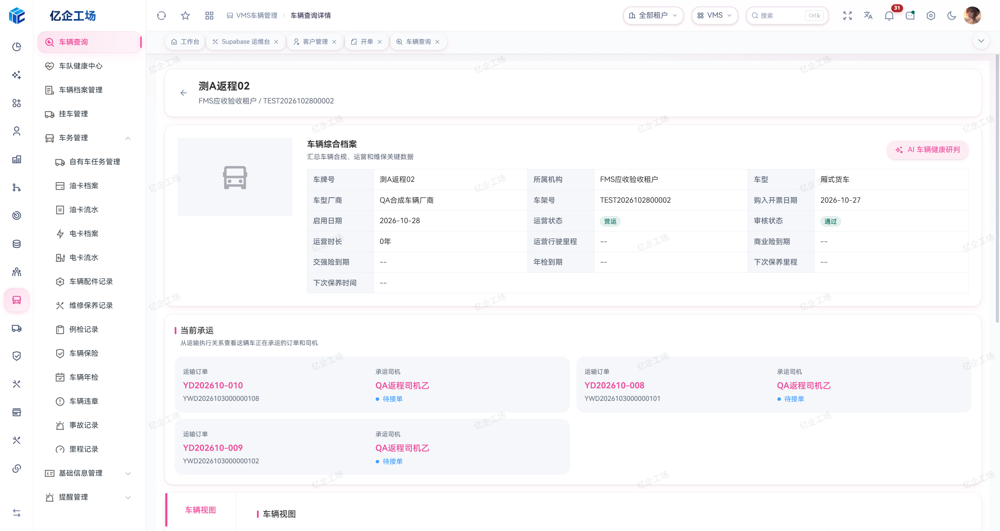

### 审批工作台与流程治理

审批中心统一承载待办、已处理、我发起、离岗委托和租户隔离；流程定义采用版本化治理，已发布版本保持不可变，可查看节点快照与版本差异。

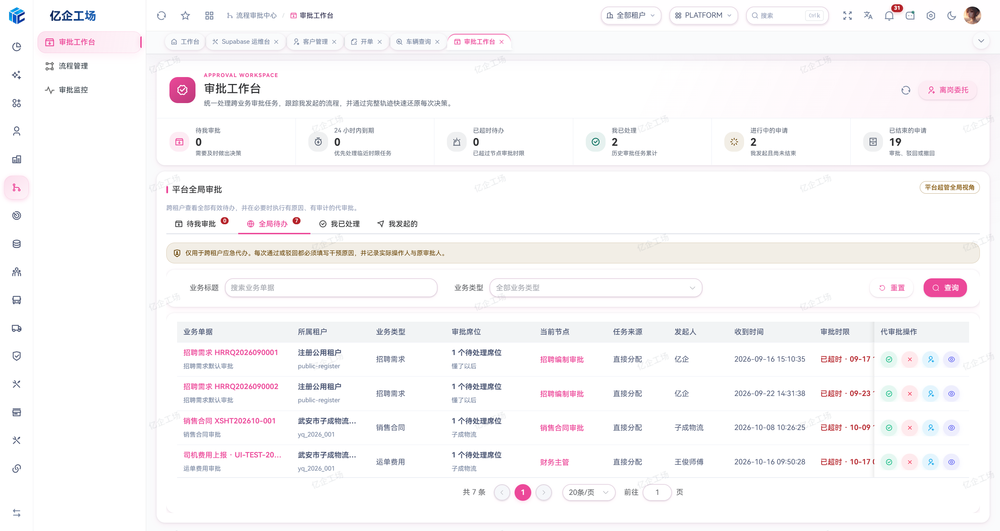

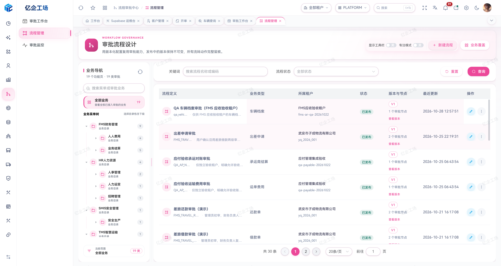

### Supabase AI 项目助手

统一浏览 Database、视图、函数、触发器、RLS 与 Edge Functions。项目助手基于实时元数据提供只读分析与治理建议，不直接执行 SQL 或修改项目。

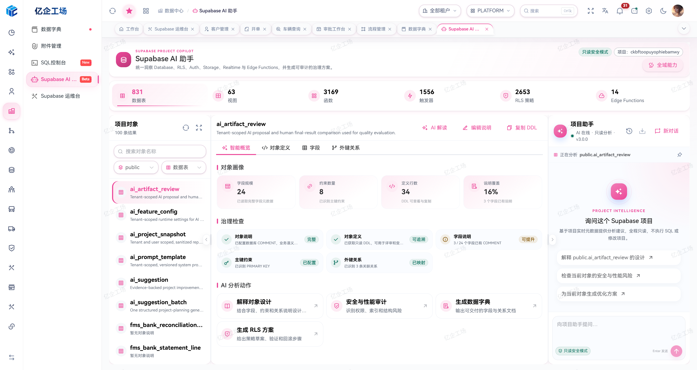

### 运输财务工作台

集中展示应收、应付、回款、付款、开票、费用审核、核销进度和运输毛利，并提供 AI 回款风险研判。

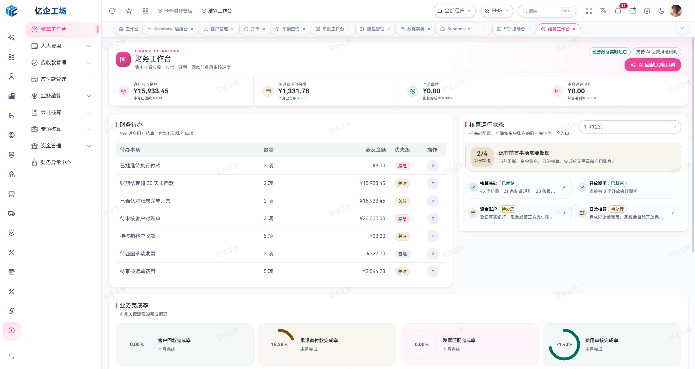

### AI 运行与质量运营

对 AI 调用次数、成功率、响应耗时、Token 消耗、能力分布、OCR/填单质量、用户反馈和失败原因进行统一观测，让 AI 能力可追踪、可评价、可持续改进。

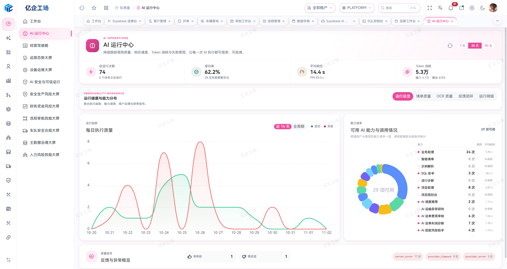

### HR 人员与组织运营

围绕组织、岗位和员工身份建立连续的人事数据主线，并在同一工作区展示任职状态、组织归属、岗位、用工类型、系统账号与完整履历。

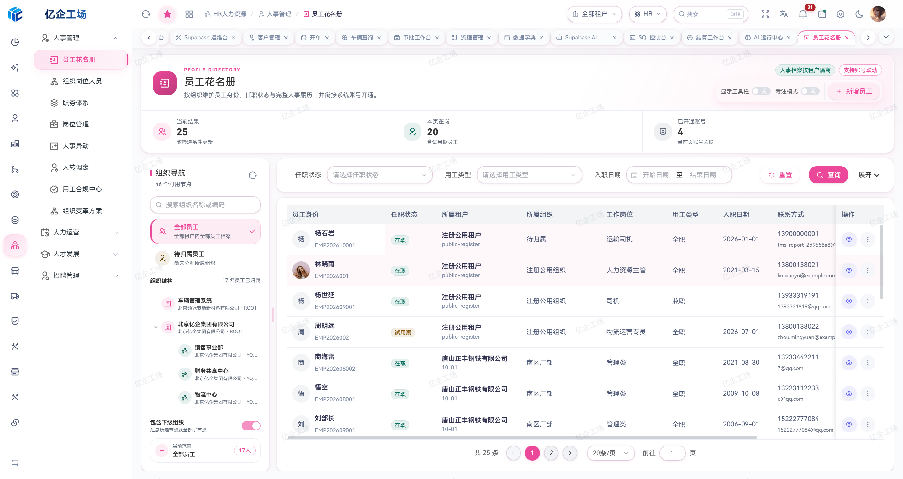

### SMIS 安全生产治理

通过安全基础资料、设备台账、资质培训、应急救援、反违章、劳保工器具和事故管理形成可追溯闭环；演练计划明确关联预案、周期、组织、负责人和预警状态。

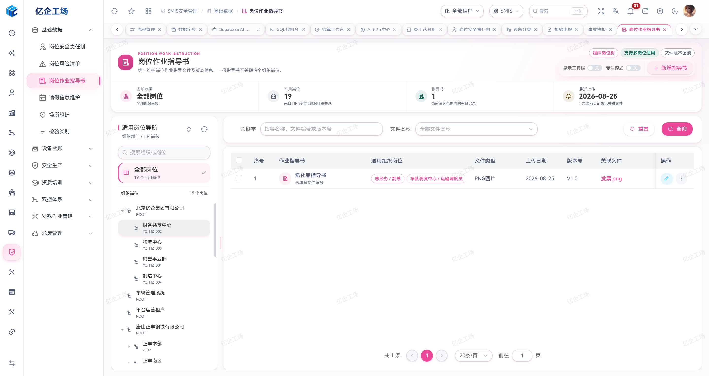

### TMS 司机移动工作台

司机端以 H5 与微信小程序承接运输执行，集中呈现绑定车辆、当前任务、运输节点、剩余里程与现场操作入口，并与 Web 管理端共享受控的运单履约状态。

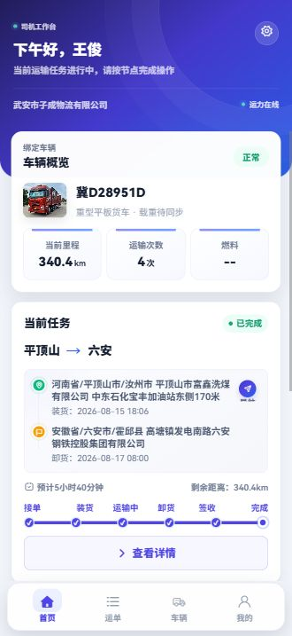

<details>
<summary><strong>查看更多：登录体验、运输开单与 AI SQL 工作台</strong></summary>

### 企业级登录体验

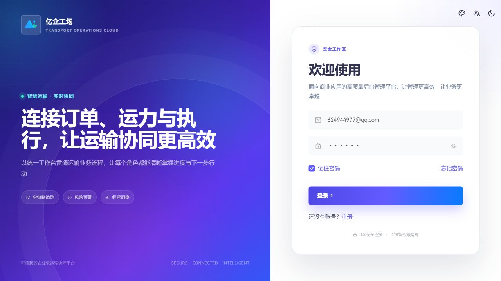

### 运输开单工作区

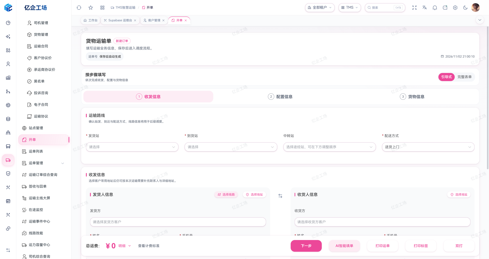

### AI SQL 工作台

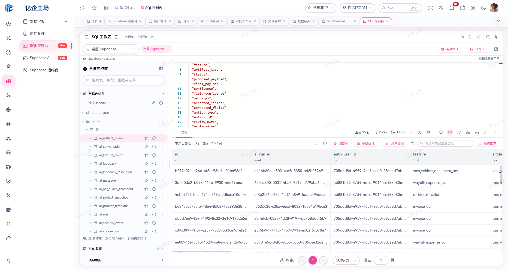

</details>

## 业务模块

### MDM 主数据、SCM 供应链与 WMS 仓储

- MDM：跨应用治理目录、质量整改、变更、黄金记录与分发治理；物料与仓储基础、编码规则、BOM、单据与业务类型、生产日历、工作中心、工艺路线与配件加工清单。
- SCM：销售报价、项目报价、销售合同与订单、发货通知和装车，以及采购申请、合同、订单、收料通知和委外业务。
- WMS：采购与销售出入库、生产领退料、完工入退库、调拨、盘点、批次与序列号、库存台账及物料收发明细。
- 已接通的来源链路包括采购订单/收料通知下推入库、发货通知进入销售出库、MES 工单领料和完工实绩入库；库存以实际过账结果为准。

### MES 制造执行与 PMIS 设备管理

- MES：生产工单、工艺/BOM 快照、计划排程、甘特图、现场任务、生产报工与审核、排包，以及质量与生产分析入口。
- 完工入库联动报工量、完全领料控制及质量状态；排包按确认与发布状态控制入库来源。
- PMIS：设备点检、巡检、预防性维护、保养与维修的计划、任务、记录、看板和分析。
- 生产报工与设备维护分别保留各自的权限、状态和审计；页面范围不代表所有现场采集与跨系统链路已完成。

### TMS 运输管理

- 基础资料：客户、客户地址、客户价格、承运商、承运商价格、司机、货物、合同、站点。
- 运输执行：智能开单、订单列表、待配载、已配载、配送签收、回单识别、异常工单、在途监控。
- 财务结算：客户对账、承运商对账、收付款、核销、发票、运单费用、利润分析。
- AI 辅助：填单、调度、异常研判、费用审核、利润诊断、回款风险、承运商评估、发票与凭证识别。
- 经营运营：返程任务、司机提成、证件派车门禁，以及 15 个经营与运营报表入口；缺少核算来源或权限时保留待核算状态。

### FMS 财务管理

- 运输结算：客户/承运商对账、收付款、发票、运单费用、利润与应收账龄。
- 资金与核算：资金账户、日记账、调拨、银行对账、凭证、自动入账、账簿、报表与结账。
- 专项财务：付款申请、费用报销、票据、税务、固定资产、薪资和异常中心。

### HR 人力资源

- 组织与人员：组织设计、岗位与职务体系、编制、花名册、档案和入转调离。
- 人才与运营：招聘、考勤、休假、薪酬福利、绩效、学习发展、继任、人才盘点与内部流动。
- 治理与服务：合规、政策签收、员工关系、自助服务、人员分析和用工风险。

### SMIS 安全生产

- 安全基础与设备：岗位风险、安全责任、作业指导、场所、供应商、设备与特种设备台账。
- 资质培训：课程、题库、考试、培训计划/记录/统计与各类安全资格证书。
- 生产安全：应急预案与演练、反违章、制度文档、劳保用品、工器具和事故管理。
- 双重预防与专项业务：风险辨识评价、分级管控、四色图、检查与隐患整改、特殊作业申请和预检，以及危废目录和出入库记录。

### 司机协同端

- 接单、装卸货定位打卡、发车、到达、签收、收车与运输轨迹。
- 现场照片、磅单、回单、签字、里程和费用凭证移动采集。
- 费用上报与 OCR 辅助识别，审批状态与 Web 管理端同步。

### 车辆管理

- 车辆档案录入、编辑、审核和详情聚合。
- 保险、年检、违章、事故、维修保养、例检和里程记录。
- 零部件、分类、供应商、领用与寿命跟踪。
- 保险、年检、保养、配件与车辆寿命提醒，支持风险工单与健康研判。

### 审批中心

- 跨业务审批工作台：待我审批、我已处理、我发起的。
- 流程定义、草稿与发布版本、条件节点、会签/或签、SLA 与版本差异。
- 审批、驳回、撤回、转交、委托、催办和完整操作轨迹。
- 业务回调 Outbox、失败重试、死信与人工补偿。

### 数据与 AI

- Monaco SQL 工作台：PostgreSQL 编辑、格式化、补全、JOIN 推断、错误定位与结果查看。
- AI 生成 SQL 与错误修复，结合项目 Schema 摘要减少表名、字段名幻觉。
- Supabase 项目对象浏览和只读项目助手。
- AI 配置、提示词、运行记录、质量指标、用户反馈与问题闭环。
- 多数据源只读查询、独立 SQL 执行端、授权查询 API 与结果分析工具；普通用户按连接或 API 授权使用，平台 Supabase 原始 SQL 执行仍仅限平台超级管理员。
- 统一智能识别工作台、识别记录与人工复核入口，保留业务确认和受控写入边界。
- 经营、财务风险、安全生产、车队合规、资产维护、人员、流程效率和数据治理等驾驶舱与指挥屏入口。

## 技术架构

业务菜单由 Supabase `sys_menu` 提供。菜单的完整访问路径、`component` 路径与业务子仓 `src/views` 下的视图目录逐段对应；详情路由的 `:id` 等参数不进入文件目录。多个菜单共用一个实现时，每个访问路径仍有自己的视图入口，复用实现放在 `views/components`。

主仓负责通用工具、组合式能力和跨仓业务组件，子仓通过 `@/` 引用唯一实现；领域规则留在所属仓库。依赖、补丁、权限、复用与 UI 审计共同检查主子仓契约，避免复制公共运行时后独立漂移。

```text
Vue 3 + TypeScript + Element Plus
              │
       统一 API Provider 层
              │
┌─────────────┴────────────────────────────────────┐
│ Supabase Auth │ PostgreSQL + RLS │ Storage       │
│ Realtime      │ RPC / Functions  │ Edge Functions│
└─────────────┬────────────────────────────────────┘
              │
    MDM / SCM / MES / WMS / TMS / VMS / PMIS / FMS / HR / SMIS
```

## 技术栈

| 分类        | 技术                                                               |
| ----------- | ------------------------------------------------------------------ |
| 前端框架    | Vue 3、TypeScript、Vite、Vue Router、Pinia                         |
| UI 与可视化 | Element Plus、SCSS、Tailwind CSS、ECharts、Vue Flow                |
| 数据与后端  | Supabase、PostgreSQL、RLS、Realtime、Storage、Edge Functions       |
| 编辑与文件  | Monaco Editor、Tiptap、ExcelJS、File Viewer、XGPlayer              |
| 工程质量    | ESLint、Prettier、Stylelint、vue-tsc、Playwright、Node Test Runner |

## 快速开始

### 环境要求

- Node.js `>= 22.13.0`
- pnpm `>= 11.28.2`（当前锁定 `11.28.2`）
- 已配置业务数据库、Auth、Storage 和所需 Edge Functions 的 Supabase 项目；安装前端依赖不会自动创建后端

### 1. 获取代码

```bash
git clone --recurse-submodules https://gitee.com/art-si/art-supabase-pro.git
cd art-supabase-pro
pnpm install
```

也可使用 [GitHub 镜像](https://github.com/art-si/art-supabase-pro) 克隆主仓；`.gitmodules` 默认从 Gitee 获取子仓。已有非递归克隆执行 `git submodule update --init --recursive`。按主仓锁定版本安装业务依赖可用 `pnpm modules:install`，完整准备与构建可用 `pnpm modules:setup`。

共享依赖补丁由主仓 `patches/` 维护。Element Plus 2.14.7 的补丁修复数字输入框解除禁用后 `aria-disabled` 不更新的问题，同时覆盖 ES Module 和 CommonJS。业务子仓保留相同补丁以支持独立安装；更新主仓补丁后运行 `pnpm dependencies:sync-patches` 同步副本，`pnpm dependencies:audit` 会检查配置和内容一致性。上游修复后，升级依赖时应移除对应补丁并重新验证表单禁用切换。

### 2. 配置环境变量

在项目根目录配置 `.env` 或 `.env.development`：

```env
VITE_SUPABASE_URL=https://your-project.supabase.co
VITE_SUPABASE_KEY=your-supabase-anon-key

# 使用在途地图时配置
VITE_AMAP_KEY=your-amap-key
VITE_AMAP_SECURITY_JS_CODE=your-amap-security-code
```

> 前端使用 Supabase 公开 publishable key 或兼容的 `anon` key。不要把 `service_role` key、AI Provider 密钥或其他服务端凭证放进 Vite 环境变量；权限安全必须由 RLS、数据库函数和 Edge Functions 在服务端边界保证。

本地联调可在忽略的 `.env.development.local` 配置 BFF 同源桥接：

```env
VITE_BFF_DEV_ENDPOINT=/__bff_bridge
BFF_DEV_PROXY_TARGET=http://127.0.0.1:3037
BFF_DEV_BRIDGE_PORT=3037
BFF_SERVICE_URL=http://localhost:3012
BFF_PRO_ALLOWED_ORIGINS=http://localhost:3036
# 与 BFF 服务端相同的专用 32 字节 Base64 签名密钥，仅限服务端读取
BFF_PRO_BRIDGE_SECRET=
```

`BFF_DEV_PROXY_TARGET` 仅由本地 Vite 服务读取，必须指向本机 HTTP 源站；浏览器只调用同源 `/__bff_bridge` 并使用已有 pro 登录会话。后端验证该身份，再按 BFF 成员和应用授权执行调用。未配置独立 HTTPS BFF 域名时只做本地演示；正式站点默认调用 `bff-gateway` Edge Function。桥接签名密钥、BFF 服务密钥和数据库密钥只能配置在服务端，不能使用 `VITE_` 前缀。

菜单管理中的 `BffIntegration` 位于“数据中心”目录，访问地址保持 `/examples/bff-integration`，视图组件为 `/data-center/bff-integration/index`。入口是否可见由 `sys_menu`、`sys_role_menu` 中的菜单与角色授权决定，页面内的接口目录和调用仍由 BFF 服务端单独授权。菜单登记后可运行 `tests/integration/bff-menu-placement.sql` 核验层级、地址和授权。

本地先运行 `pnpm bff:dev-bridge`，再启动指定端口的 Pro。该适配器与正式 Edge Function 复用同一 handler 和 Pro 用户检查。正式部署 `bff-gateway` 时配置 HTTPS `BFF_SERVICE_URL`、专用 `BFF_PRO_BRIDGE_SECRET` 和准确的允许来源；函数自行使用 `Auth.getUser` 验证 JWT，再检查启用的 Pro 用户资料，不接受浏览器提交的用户 ID 或管理员身份。

专项视觉回归使用已开启 BFF 的本地主机和授权测试会话：设置 `E2E_BFF_INTEGRATION=true`、`E2E_BASE_URL=http://localhost:3036` 后运行 `pnpm exec playwright test tests/e2e/bff-integration.spec.ts --project=desktop-1440 --no-deps`。该专项只模拟桥接响应以验收页面，服务端签名、权限与真实上游调用另由 BFF HTTP 集成测试验证；默认 Pro 全量页面回归不启用此可选模块。

### 3. 启动开发环境

```bash
pnpm dev
```

主仓与 Vue 业务子仓统一使用 `sass-embedded`。Sass 全局注入由 `scripts/scss-globals.mjs` 维护：普通组件只注入共用混合宏，平台全局样式与 Element Plus 主题源码继续加载配置过的主题变量；子仓不要另行复制注入规则。

开发性能排查应分别测量服务器启动、首次页面加载和实际文件热更新。使用具体 hooks 时直接导入对应的 `@/hooks/core/**` 或 `@/hooks/component/**` 文件，避免统一导出入口把无关控件带入当前页面的加载链路。

### 4. 质量检查与构建

```bash
pnpm check
pnpm build
```

常用命令：

| 命令 | 说明 |
| --- | --- |
| `pnpm dev` | 启动开发服务器 |
| `pnpm sql:gateway` | 启动外接数据库只读查询的本机后台执行端 |
| `npm run dev:cloudbase` | 本地启动前端，连接 `.env.cloudbase` 配置的 CloudBase 后端 |
| `pnpm check:fast` | 运行 UI、复用、权限与数据库静态审计、类型、ESLint 和单元测试 |
| `pnpm check` | 在快速检查基础上增加 Stylelint |
| `pnpm check:ci` | 运行完整静态检查、快照校验、生产构建与核心视觉回归 |
| `pnpm lint:stylelint:fix` | 自动修复可安全处理的样式规范问题 |
| `pnpm test:e2e` | 运行完整 Playwright 端到端测试 |
| `pnpm test:e2e:core` | 运行 1440 桌面与 390 移动端核心页面视觉回归 |
| `pnpm test:e2e:install` | 安装 CI 所需的 Playwright Chromium |
| `pnpm snapshot:check` | 校验 AI 项目快照是否与当前代码一致 |
| `pnpm modules:status` | 查看全部子仓版本与初始化状态 |
| `pnpm modules:check` | 运行各子仓声明的质量检查 |
| `pnpm modules:build` | 构建全部子仓 |
| `pnpm build` | 构建生产版本 |
| `pnpm build:analyze` | 生成构建体积分析 |
| `pnpm repo:pull` | 同步拉取主仓及全部 Git 子仓 |
| `pnpm repo:publish -- "feat: 提交说明"` | 构建并校验主仓 docs，提交主仓源码与有改动子仓的源码和 docs |

统一发布命令会先检查分支和上游状态，构建所有有改动子仓的 `docs`，再构建主仓 `docs` 并检查入口文件。子仓的 `docs` 仍随各自独立站点提交；主仓的 `docs` 仅用于本地构建校验，不再提交到源码仓。主仓 GitHub Pages 由 GitHub Actions 在 GitHub 上重新构建并发布制品。提交和推送始终按照“子仓在前、主仓在后”的顺序执行；主仓先更新最终子仓版本清单，再生成并提交 AI 项目快照，结束时确认主仓与全部子仓均无未提交内容。若拉取后子仓版本领先于主仓记录，`repo:pull` 会保留新的 `gitlink`，确认后执行一次 `repo:publish` 即可提交主仓指针。

`repo:publish` 会提交当前工作区除主仓 `docs/` 外的改动，并推送各仓当前配置的上游；运行前应整理待发布内容。若主仓 `docs/` 仍被 Git 跟踪，命令会在构建前提示先停止跟踪。GitHub 与 Gitee 的镜像同步需要分别推送，命令不会自动发现第二个平台。

## 项目结构

```text
art-supabase-pro/
├─ src/
│  ├─ api/                         # 统一 API 与 Supabase Provider
│  ├─ components/core/             # 表格、表单、弹窗、抽屉、选择器等核心组件
│  ├─ hooks/                       # 通用组合式能力
│  ├─ store/                       # Pinia 状态管理
│  ├─ views/
│  │  ├─ dashboard/                # 运营工作台与 AI 运行中心
│  │  ├─ data-center/              # 数据字典、附件、SQL 与 Supabase AI
│  │  ├─ system/                   # 用户、角色、菜单、租户、参数、AI 配置
│  │  └─ workflow/                 # 审批工作台、流程设计与监控
│  └─ utils/                       # 通用工具
├─ modules/
│  ├─ art-supabase-doc/            # 官方 VitePress 文档站
│  ├─ art-supabase-fms/            # FMS 财务管理应用
│  ├─ art-supabase-hr/             # HR 人力资源应用
│  ├─ art-supabase-mdm/            # 主数据治理与生产基础
│  ├─ art-supabase-mes/            # MES 制造执行应用
│  ├─ art-supabase-pmis/           # PMIS 设备管理应用
│  ├─ art-supabase-scm/            # SCM 供应链管理子仓
│  ├─ art-supabase-site/           # 亿企工场独立官网
│  ├─ art-supabase-smis/           # SMIS 安全生产应用
│  ├─ art-supabase-tms/            # TMS 智慧运输应用
│  ├─ art-supabase-vms/            # VMS 车辆管理应用
│  └─ art-supabase-wms/            # WMS 仓储管理应用
├─ supabase/
│  ├─ functions/                   # Edge Functions
│  └─ migrations/                  # 历史说明；当前数据库变更直接执行并验证
├─ tests/                          # 单元、浏览器、SQL 集成与 PowerShell 测试
└─ screenshots/                    # README 产品截图
```

测试目录的用途、SQL 执行边界和提交原则见 [tests/README.md](tests/README.md)。

主仓 `docs/` 是本地构建校验产物，由 Git 忽略；GitHub Pages 使用 Actions 构建并发布的制品。业务子仓的 `docs/` 仍是各自独立站点的版本化发布产物；`modules/art-supabase-doc/docs/` 则是文档站源文件，不能当作主仓构建产物清理。测试源码、测试夹具和视觉基准需要版本控制；本机 IDE 状态、数据库缓存、运行日志、覆盖率、测试报告、认证会话和一次性排查证据放在忽略目录中，不提交。取消文件跟踪只影响后续提交，不会删除远端 Git 历史；历史瘦身需要单独协调，不能通过强推混入普通清理。

## 安全与权限原则

- 所有业务数据按租户隔离，数据库层启用 RLS。
- 仅平台超级管理员可切换租户：全部租户读取跨租户数据，选定租户后按该租户读取。全部租户下新建根记录默认归属管理员认证租户；已有记录和子记录写入继承明确的记录/父记录租户。
- 普通用户可以使用租户范围内、业务数据安全的只读 AI；具备对应业务 `Add` 权限时，也可通过 AI 创建本租户的主数据。
- 其他 AI 业务修改、配置、发布、流程状态变更与受控写入仅允许平台超级管理员，且必须同时经过 UI 和服务端权限校验。
- AI 历史、运行日志、生成物与反馈可作为审计数据保存，不得绕过业务写权限。
- 主数据删除统一先检查业务引用，展示可识别的阻断记录和获准导航；检查失败时阻止删除，服务端继续执行引用、租户与权限约束。

## 开源与贡献

项目采用 [木兰宽松许可证第 2 版（MulanPSL-2.0）](LICENSE) 开源。欢迎提交 Issue、Pull Request，也欢迎分享你的 Supabase、TMS、车辆管理和 AI 业务实践。

界面使用 HarmonyOS Sans 字体，版权 © Huawei Device Co., Ltd.；字体文件遵循单独的 [HarmonyOS Sans Fonts License Agreement](public/fonts/HarmonyOS-Sans-LICENSE.txt)。

感谢开源社区对基础界面能力的贡献。
